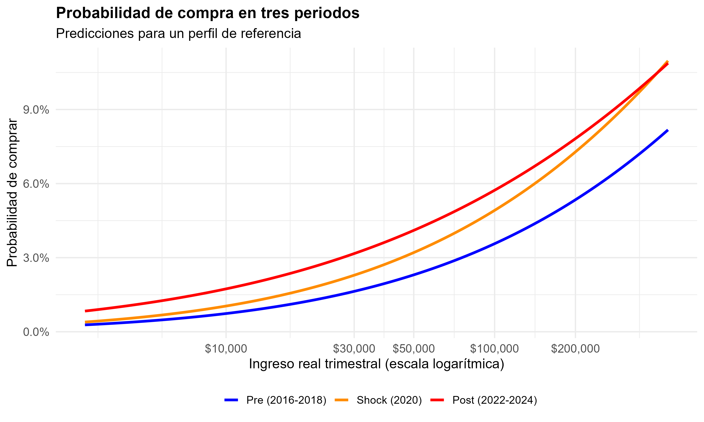
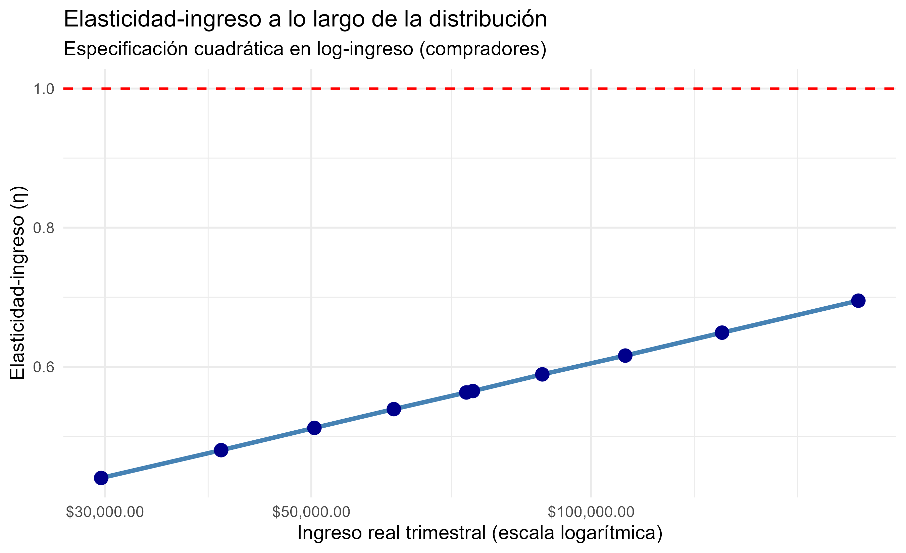
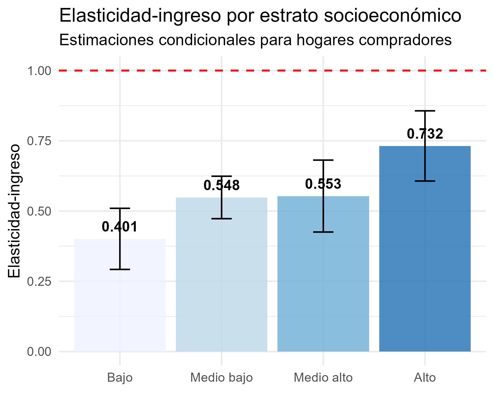

# Consumo discrecional y heterogeneidad de los hogares en México: Evidencia del gasto en jardinería doméstica, 2016-2024


[](https://www.r-project.org/)
[](https://opensource.org/licenses/MIT)

**Autor:** Daniel Zamora Calderón  
**Asesor:** Roberto Gutiérrez Rodríguez  
**Institución:** Universidad Autonoma Metropolitana, Departamento de Economía, DCSH (Trimestre 2026-O)

---

## Descripción

Este repositorio contiene el código y los avances de la investigación terminal *"Consumo discrecional y heterogeneidad de los hogares en México: Evidencia del gasto en jardinería doméstica, 2016-2024"*. 

La investigación analiza la evolución del gasto discrecional de los hogares mexicanos en el rubro de productos de jardinería entre 2016 y 2024, con especial énfasis en la relación entre ingreso, participación e intensidad del gasto. Para ello, se emplea un **modelo de dos partes (Cragg, 1971)** aplicado a los microdatos de la Encuesta Nacional de Ingresos y Gastos de los Hogares (ENIGH).

## Hallazgos Principales (Avance)

- **Expansión del mercado:** La proporción de hogares compradores pasó de **1.77% en 2016 a 4.95% en 2024**, con un incremento notable tras el periodo de confinamiento.
- **Margen Extensivo vs. Intensivo:** La transformación observada se concentró fundamentalmente en el margen extensivo (incorporación de nuevos hogares al mercado) y no en el margen intensivo (monto gastado por quienes ya compraban).
- **Elasticidad-Ingreso:** La elasticidad-ingreso condicional se mantuvo estable en **0.604**, caracterizando al rubro como un bien normal. La curva de Engel estimada resultó convexa.
- **Educación:** El capital cultural (educación del jefe) está fuertemente asociado con la probabilidad de participación, pero no así con la intensidad del gasto (excepto en el nivel superior).

*Nota metodológica: El uso de cortes transversales repetidos limita la identificación de efectos causales estrictos del shock pandémico.*

## Resultados Visuales

### Probabilidad de compra en tres periodos


### Curva de Engel (Elasticidad por decil)


### Elasticidad-ingreso por estrato socioeconómico


## Estructura del Repositorio

```text
.
├── code/                  # Scripts modulares en R
│   ├── 00_config.R        # Configuración, rutas y librerías
│   ├── 01_limpieza.R      # Construcción del pool y armonización COICOP
│   ├── 02_descriptivos.R  # Tablas de participación y perfiles
│   ├── 03_modelo_cragg.R  # Estimación Probit y Log-lineal
│   ├── 04_robustez.R      # Pruebas de especificación y sensibilidad
│   └── 05_graficos.R      # Generación de figuras
├── data/                  # Carpeta para microdatos (NO incluida en el repo)
│   └── README.md          # Instrucciones de descarga de ENIGH
├── tablas_tesis/          # Resultados en formato CSV
└── graficos_tesis/        # Figuras en PNG